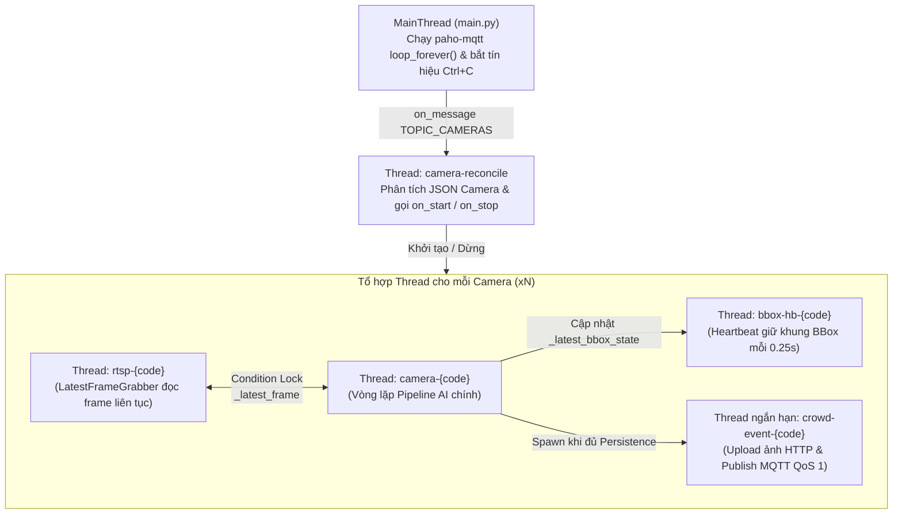
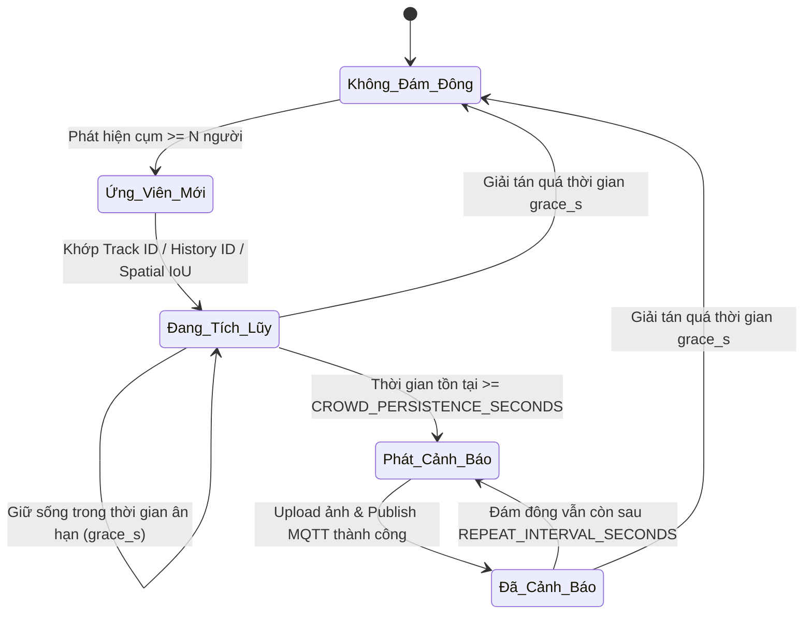

# 🛠️ Tài liệu Kiến trúc & Hướng dẫn Phát triển (`DEVELOPER_GUIDE.md`)

Tài liệu này được biên soạn dành riêng cho **Nhà phát triển (Developers), Kỹ sư AI/Computer Vision và Kỹ sư Hệ thống** nhằm giải thích chi tiết ý tưởng thiết kế, luồng dữ liệu, mô hình lập trình đa luồng, các thuật toán cốt lõi và cách tùy biến/mở rộng hệ thống **Smart VMS Crowd Detection**.

---

## Mục lục
1. [Bài toán & Ý tưởng Thiết kế Cốt lõi](#1-bài-toán--ý-tưởng-thiết-kế-cốt-lõi)
2. [Kiến trúc Đa luồng & Quản lý Vòng đời (Concurrency Model)](#2-kiến-trúc-đa-luồng--quản-lý-vòng-đời-concurrency-model)
3. [Phân tích Chi tiết Từng Module Mã nguồn](#3-phân-tích-chi-tiết-từng-module-mã-nguồn)
4. [Giải thuật Cốt lõi (Core Algorithms Deep-Dive)](#4-giải-thuật-cốt-lõi-core-algorithms-deep-dive)
   - [4.1. Đọc RTSP Độ trễ bằng 0 (`LatestFrameGrabber`)](#41-đọc-rtsp-độ-trễ-bằng-0-latestframegrabber)
   - [4.2. Chia sẻ Trọng số YOLO & Cô lập ByteTrack (`PersonDetector`)](#42-chia-sẻ-trọng-số-yolo--cô-lập-bytetrack-persondetector)
   - [4.3. Phân cụm Khoảng cách Hiệu chỉnh Phối cảnh 2.5D (`ProximityEvaluator`)](#43-phân-cụm-khoảng-cách-hiệu-chỉnh-phối-cảnh-25d-proximityevaluator)
   - [4.4. Xác thực Đám đông theo Thời gian & Không gian (`CrowdPersistence`)](#44-xác-thực-đám-đông-theo-thời-gian--không-gian-crowdpersistence)
   - [4.5. Đồng bộ BBox Thời gian thực & Cơ chế Heartbeat](#45-đồng-bộ-bbox-thời-gian-thực--cơ-chế-heartbeat)
5. [Các Quyết định Kỹ thuật Quan trọng (Design Decisions & Lessons Learned)](#5-các-quyết-định-kỹ-thuật-quan-trọng-design-decisions--lessons-learned)
6. [Hướng dẫn Mở rộng & Tùy biến cho Lập trình viên](#6-hướng-dẫn-mở-rộng--tùy-biến-cho-lập-trình-viên)

---

## 1. Bài toán & Ý tưởng Thiết kế Cốt lõi

### 1.1. Thách thức của bài toán Giám sát Đám đông qua CCTV
Khi triển khai AI xử lý nhiều luồng camera RTSP đồng thời để phát hiện đám đông và hiển thị lên Web VMS, hệ thống phải giải quyết 5 bài toán thực tế:
1. **Độ trễ luồng RTSP (Stream Latency & Buffer Bloat):** Nếu tốc độ suy luận AI chậm hơn tốc độ phát của camera dù chỉ vài mili-giây, bộ đệm (buffer) của FFmpeg sẽ bị ứ đọng, khiến AI xử lý hình ảnh của vài giây trước hoặc gây lỗi giải mã H.265 (`Could not find ref with POC`).
2. **Giới hạn VRAM/RAM khi chạy nhiều Camera:** Nạp $N$ bản sao mô hình YOLOv8 (`imgsz=1280`) cho $N$ camera sẽ nhanh chóng làm tràn VRAM (ví dụ card RTX A400 chỉ có 4GB VRAM) hoặc mất hàng chục giây biên dịch OpenVINO trên CPU.
3. **Biến dạng phối cảnh Camera (Perspective Distortion):** Camera giám sát thường lắp trên cao chiếu xiên xuống. Hai người đứng ở xa camera có khoảng cách pixel nhỏ hơn rất nhiều so với hai người đứng gần camera, và khoảng cách theo chiều sâu (trục dọc $Y$ trên ảnh) bị nén mạnh hơn chiều ngang (trục $X$).
4. **Hiện tượng nhấp nháy ID (ID Switch / Occlusion):** Trong đám đông, người này dễ che khuất người kia trong 1–2 khung hình khiến YOLO tạm thời không bắt được hoặc ByteTrack đổi `track_id`. Nếu bộ đếm thời gian tụ tập (`Persistence`) chỉ dựa vào sự hiện diện liên tục tuyệt đối trên từng frame, bộ đếm 5 giây sẽ liên tục bị reset về 0.
5. **Độ mượt của Bounding Box trên Web VMS:** Giao diện Web VMS tự động xóa khung vẽ BBox nếu quá `0.35 giây` không nhận được bản tin mới, đồng thời hiển thị video trực tiếp qua WebRTC với độ trễ cực thấp.

### 1.2. Triết lý thiết kế của hệ thống
- **Event-Driven & Stateless Configuration:** Hệ thống không lưu cứng danh sách camera trong code hay DB riêng. Mọi trạng thái bật/tắt camera đều được đồng bộ tự động từ Retained Message của MQTT Broker.
- **Decoupled Pipeline (Tách rời các khâu Đọc – Suy luận – Gửi sự kiện):**
  - Khâu đọc RTSP chạy ở tốc độ gốc của camera (luôn vứt bỏ frame cũ, chỉ giữ 1 frame mới nhất).
  - Khâu suy luận AI luôn lấy frame có độ tuổi `0 ms` ngay tại thời điểm bước vào GPU.
  - Khâu upload ảnh HTTP và gửi sự kiện cảnh báo chạy bất đồng bộ (Async Thread) để không bao giờ làm khựng luồng vẽ BBox thời gian thực.

---

## 2. Kiến trúc Đa luồng & Quản lý Vòng đời (Concurrency Model)

Với $N$ camera đang hoạt động (ví dụ $N = 4$), hệ thống vận hành các luồng (threads) như sau:



### Cơ chế Đồng bộ & Khóa An toàn (Thread-Safety Locks)
Để tránh xung đột dữ liệu (Race Condition) và tránh Deadlock, hệ thống sử dụng các khóa chuyên biệt có phạm vi nhỏ:
1. **`reconcile_lock` & `workers_lock` (`src/mqtt_client.py`):** Đảm bảo các bản tin cập nhật danh sách camera từ MQTT được xử lý tuần tự và việc thêm/xóa `CameraWorker` trong từ điển `camera_workers` hoàn toàn an toàn.
2. **`_SHARED_MODEL_LOCK` & `_INFERENCE_SEMAPHORE` (`src/detector.py`):**
   - `_SHARED_MODEL_LOCK`: Bảo vệ việc khởi tạo mô hình YOLO dùng chung lần đầu tiên.
   - `_INFERENCE_SEMAPHORE`: Điều tiết số luồng chạy qua mô hình YOLO cùng lúc (`MAX_CONCURRENT_INFERENCES=1`) và bảo vệ việc hoán đổi trạng thái bộ lọc `ByteTrack` của từng camera.
3. **`_MQTT_PUBLISH_LOCK` (`src/publisher.py`):** Bảo vệ lệnh `client.publish()` khi nhiều luồng (`camera-*` và `bbox-hb-*`) cùng gửi dữ liệu qua kết nối MQTT WebSocket, ngăn ngừa lỗi hỏng khung dữ liệu WebSocket gây ngắt kết nối (`rc=4`).

---

## 3. Phân tích Chi tiết Từng Module Mã nguồn

| Tệp mã nguồn | Vai trò & Trách nhiệm chính | Các hàm / Lớp quan trọng |
| :--- | :--- | :--- |
| **`main.py`** | Điểm vào ứng dụng; khởi tạo logging, đăng ký `signal.SIGINT`/`SIGTERM` để dừng toàn bộ worker song song trước khi đóng MQTT client. | `main()`, `_shutdown()` |
| **`src/config.py`** | Nạp biến môi trường từ `.env`, thiết lập cờ FFmpeg Low-Latency (`rtsp_transport;tcp`, `nobuffer`, `low_delay`) trước khi nạp OpenCV, và kiểm tra tính hợp lệ (Validation) của các ngưỡng cấu hình. | `_env_bool()`, các hằng số cấu hình |
| **`src/setup_logging.py`** | Thiết lập bộ ghi log đồng thời ra màn hình Console (`stdout`) và tệp `logs/app.log` (`RotatingFileHandler`, tự xoay vòng khi đạt 10MB). | `setup_logging()` |
| **`src/mqtt_client.py`** | Thiết lập kết nối MQTT qua WebSocket (hỗ trợ cả WS thường và WSS/TLS), tự động Subscribe `smart_vms/cameras/zone/{ZONE_ID}` khi kết nối/kết nối lại, đẩy việc Reconcile sang luồng nền để không chặn luồng mạng Paho. | `build_client()`, `on_start()`, `on_stop()`, `stop_camera_workers()` |
| **`src/camera_manager.py`** | Phân tích JSON danh sách camera từ VMS, lọc các camera có bật `MODULE`, tính toán tập hợp cần `stop` (bị xóa hoặc đổi URL/ID) và tập hợp cần `start` (mới thêm hoặc vừa cập nhật). | `Camera` (frozen dataclass), `CameraManager.get_camera()`, `_reconcile()` |
| **`src/detector.py`** | Quản lý mô hình nhận diện người YOLOv8 và thuật toán theo dõi ByteTrack. Tự động chọn Backend tối ưu (`CUDA FP16` / `OpenVINO` / `CPU`). | `PersonDetector`, `_select_runtime()`, `track()`, `predict()` |
| **`src/analyze.py`** | Phân cụm các hộp giới hạn người thành các nhóm đám đông dựa trên khoảng cách đã chuẩn hóa theo phối cảnh. | `ProximityEvaluator`, `clusters()`, `are_close()` |
| **`src/camera_worker.py`** | Trái tim của hệ thống: điều phối luồng đọc RTSP (`LatestFrameGrabber`), gọi `PersonDetector`, `ProximityEvaluator`, quản lý trạng thái đám đông (`CrowdPersistence`), gửi BBox và sinh luồng gửi sự kiện cảnh báo. | `LatestFrameGrabber`, `CrowdPersistence`, `CameraWorker._run()` |
| **`src/publisher.py`** | Tải ảnh chụp sự kiện lên Storage API thông qua `requests.Session` (tái sử dụng kết nối TCP/TLS với `HTTPAdapter`) và gửi bản tin MQTT Event (`QoS 1`) / BBox (`QoS 0`). | `upload_snapshot()`, `publish_crowd_event()`, `publish_bbox()` |

---

## 4. Giải thuật Cốt lõi (Core Algorithms Deep-Dive)

### 4.1. Đọc RTSP Độ trễ bằng 0 (`LatestFrameGrabber`)

**Vấn đề:** Nếu gọi `capture.read()` trực tiếp trong vòng lặp xử lý AI, trong thời gian AI đang bận suy luận (`35ms` trên GPU hoặc `350ms` trên CPU), các khung hình mới từ camera gửi tới sẽ nằm chờ trong bộ đệm socket của hệ điều hành và bộ đệm demuxer của FFmpeg. Kết quả là lần gọi `capture.read()` tiếp theo sẽ lấy ra **khung hình cũ từ quá khứ**.

**Giải pháp (trong `src/config.py` & `src/camera_worker.py`):**
1. **Ở tầng C/FFmpeg (`src/config.py`):**
   Thiết lập biến môi trường trước khi khởi tạo `cv2.VideoCapture`:
   ```python
   os.environ.setdefault(
       "OPENCV_FFMPEG_CAPTURE_OPTIONS",
       "rtsp_transport;tcp|fflags;nobuffer|flags;low_delay|max_delay;0",
   )
   ```
   - `rtsp_transport;tcp`: Ngăn chặn mất gói tin UDP gây vỡ hình hoặc lỗi thiếu khung tham chiếu `POC` trên luồng nén H.265/HEVC.
   - `fflags;nobuffer|flags;low_delay|max_delay;0`: Buộc bộ giải mã FFmpeg trả khung hình ra ngay lập tức mà không tích trữ trong bộ đệm.
2. **Ở tầng Python (`LatestFrameGrabber`):**
   - Luồng `_reader_loop()` chạy vòng lặp `capture.read()` liên tục ở tốc độ tối đa của luồng RTSP, ghi đè biến `self._latest_frame` và tăng bộ đếm `self._latest_seq += 1`.
   - Khi luồng AI (`CameraWorker._run`) sẵn sàng xử lý, nó gọi `get_latest_frame(last_seq)` để lấy khung hình có `seq > last_seq`.
   - **Cơ chế làm tươi giờ chót (`peek_newer_frame`):** Ngay tại thời điểm luồng AI vừa chờ xong khóa `_INFERENCE_SEMAPHORE` để bước vào GPU, callback `_refresh_latest_frame()` kiểm tra xem trong vài chục mili-giây chờ đợi vừa qua có khung hình nào mới hơn vừa tới không; nếu có, nó lập tức tráo khung hình mới nhất đó vào mô hình YOLO. Nhờ vậy, khung hình được suy luận luôn có **độ trễ bằng 0 ms**.

---

### 4.2. Chia sẻ Trọng số YOLO & Cô lập ByteTrack (`PersonDetector`)

**Vấn đề:**
- Trong thư viện Ultralytics, khi gọi `model.track(frame, persist=True)`, đối tượng `model.predictor.trackers` lưu giữ trạng thái bộ lọc Kalman (vị trí, vận tốc, lịch sử `track_id`) của các đối tượng trong video.
- Nếu 4 camera khởi tạo 4 đối tượng `YOLO()` riêng biệt: tốn gấp 4 lần VRAM/RAM và thời gian nạp model.
- Ngược lại, nếu 4 camera dùng chung 1 đối tượng `YOLO()` một cách ngây thơ: tọa độ người của Camera 1 sẽ bị đem ghép với tọa độ người của Camera 2 trong cùng một bộ lọc `ByteTrack`, làm hỏng hoàn toàn việc theo dõi ID!

**Giải pháp (trong `src/detector.py`):**
- Sử dụng bộ nhớ đệm toàn cục `_SHARED_MODELS` để chỉ nạp **duy nhất 1 đối tượng `YOLO`** cho toàn bộ tiến trình.
- Mỗi `PersonDetector` (tương ứng với 1 camera) giữ một thuộc tính riêng `self._camera_trackers`.
- Bên trong vùng khóa `_INFERENCE_SEMAPHORE` của hàm `track()`:
  ```python
  with _INFERENCE_SEMAPHORE:
      # 1. Nạp trạng thái ByteTrack riêng của camera hiện tại vào predictor
      predictor = getattr(self._model, "predictor", None)
      if predictor is not None:
          if self._camera_trackers is not None:
              predictor.trackers = self._camera_trackers
          elif hasattr(predictor, "trackers"):
              delattr(predictor, "trackers")

      # 2. Chạy suy luận & cập nhật Kalman Filter cho đúng camera này
      result = self._model.track(frame, persist=True, tracker="bytetrack.yaml", ...)[0]

      # 3. Cất lại trạng thái ByteTrack của camera hiện tại
      if predictor is not None and hasattr(predictor, "trackers"):
          self._camera_trackers = predictor.trackers
  ```
Cách làm này vừa tiết kiệm **75% bộ nhớ VRAM/RAM**, vừa đảm bảo **ByteTrack của từng camera hoàn toàn độc lập**.

---

### 4.3. Phân cụm Khoảng cách Hiệu chỉnh Phối cảnh 2.5D (`ProximityEvaluator`)

Được cài đặt tại `src/analyze.py`. Mục tiêu là xác định xem từ danh sách $M$ người trong khung hình, những ai đang đứng gần nhau để tạo thành các cụm (clusters).

#### Bước 1: Biểu diễn hình học từng người
Với mỗi hộp giới hạn người $i$ có tọa độ $(x_1, y_1, x_2, y_2)$:
- Chiều rộng: $w_i = x_2 - x_1$, chiều cao: $h_i = y_2 - y_1$
- Tâm hộp:
  $$c_{x,i} = \frac{x_1 + x_2}{2}, \quad c_{y,i} = \frac{y_1 + y_2}{2}$$
- Kích thước đặc trưng $L_i$ (tùy theo `PROXIMITY_LENGTH_MODE`):
  - `max` *(mặc định)*: $L_i = \max(w_i, h_i)$ *(chiều cao người trên ảnh, phản ánh tỷ lệ xa/gần so với ống kính camera)*
  - `min`: $L_i = \min(w_i, h_i)$
  - `diag`: $L_i = \sqrt{w_i^2 + h_i^2}$

#### Bước 2: Khoảng cách có bù phối cảnh trục dọc (`y_scale`)
Do góc lắp đặt camera CCTV nhìn từ trên cao xuống một góc nghiêng $\theta$, cùng một khoảng cách 1 mét ngoài đời thực khi nằm dọc theo chiều sâu ống kính (trục $Y$ trên ảnh) sẽ bị co ngắn lại trên ảnh 2D so với khi nằm ngang (trục $X$).
Do đó, khoảng cách hiệu dụng $D(i, j)$ giữa người $i$ và người $j$ được tính bằng:

$$D(i, j) = \sqrt{(c_{x,i} - c_{x,j})^2 + \left((c_{y,i} - c_{y,j}) \times \text{y\_scale}\right)^2}$$

Trong đó `y_scale` (`PROXIMITY_Y_SCALE`, mặc định `1.5`) kéo giãn khoảng cách theo trục dọc để khôi phục khoảng cách thực trên mặt đất.

#### Bước 3: Điều kiện kết nối cạnh & Tìm thành phần liên thông (BFS)
Hai người $i$ và $j$ được coi là **đứng gần nhau** nếu khoảng cách hiệu dụng nhỏ hơn trung bình kích thước đặc trưng của họ nhân với hệ số $\alpha$ (`PROXIMITY_ALPHA`, mặc định `1.5`):

$$D(i, j) < \alpha \times \frac{L_i + L_j}{2}$$

- Hệ thống xây dựng một đồ thị vô hướng $G = (V, E)$, trong đó mỗi người là một đỉnh $v \in V$, và mỗi cặp thỏa mãn bất đẳng thức trên tạo thành một cạnh $e \in E$.
- Sử dụng thuật toán **Tìm kiếm theo chiều rộng (BFS - Breadth-First Search)** để gom các đỉnh liên thông thành các cụm `clusters`.
- Cụm nào có số lượng phần tử $|\text{cluster}| \ge \text{NUMBER\_PERSON\_IS\_CROWDED}$ được đánh dấu là **Cụm đám đông (`crowded_clusters`)**.

---

### 4.4. Xác thực Đám đông theo Thời gian & Không gian (`CrowdPersistence`)

Được cài đặt tại lớp `CrowdPersistence` trong `src/camera_worker.py`. Đây là chốt chặn quan trọng nhất giúp hệ thống không báo động giả khi mọi người chỉ tình cờ đi lướt qua nhau, đồng thời không bị mất trạng thái khi mô hình AI bỏ sót 1–2 frame.



#### Cơ chế Đối sánh Đa tầng (3-Tier Candidate Matching)
Mỗi cụm đám đông đang được theo dõi được lưu trong đối tượng `_CrowdCandidate` gồm:
- `track_ids`: Tập hợp ID hiện tại của các cá nhân trong cụm.
- `history_track_ids`: Tập hợp toàn bộ các ID từng tham gia vào cụm này từ lúc hình thành (tối đa 64 ID).
- `bbox`: Khung chữ nhật bao quanh toàn bộ cụm đám đông ở frame gần nhất.
- `started_at`, `last_seen`: Thời điểm bắt đầu hình thành và thời điểm nhìn thấy gần nhất.

Khi có một cụm đám đông mới xuất hiện ở frame hiện tại, `CrowdPersistence.update()` chấm điểm so khớp (`score`) với các ứng viên đang sống dựa trên **3 tiêu chí**:
1. **Trùng khớp Track ID trực tiếp (`overlap`):** Có ít nhất 1 người giữ nguyên `track_id` từ frame trước ($\text{weight} = 10.0$).
2. **Trùng khớp Lịch sử Track ID (`hist_overlap`):** Trường hợp một người bị khuất 1 frame rồi xuất hiện lại hoặc người trong nhóm hoán đổi vị trí ($\text{weight} = 3.0$).
3. **Trùng khớp Không gian (`spatial_match`):** Ngay cả khi toàn bộ `track_id` bị đổi mới hoàn toàn (ID switch), nếu vị trí khung bao của cụm mới có độ chồng lấp $\text{IoU} \ge 0.25$ hoặc khoảng cách giữa 2 tâm cụm $\le 0.6 \times \text{đường chéo}$ so với cụm cũ, hệ thống vẫn nhận diện đây là **cùng một đám đông**!

#### Cơ chế Thời gian Ân hạn Thích ứng (Adaptive Grace Period)
Ứng viên đám đông không bị xóa ngay nếu biến mất trong 1 frame, mà được giữ sống trong khoảng thời gian:
$$\text{effective\_grace\_s} = \max(\text{CROWD\_TRACK\_GRACE\_SECONDS}, \text{frame\_interval\_s} \times 2.5)$$
Nhờ công thức này, dù hệ thống đang chạy ở 15 FPS trên GPU hay 0.8 FPS trên CPU yếu, đám đông vẫn chịu được việc hụt nhận diện trong 2–3 frame liên tiếp mà không bị reset bộ đếm thời gian tụ tập.

---

### 4.5. Đồng bộ BBox Thời gian thực & Cơ chế Heartbeat

Giao diện Web VMS có đặc thù: **sau `0.35 giây` không nhận được bản tin BBox mới trên topic `smart_vms/ai/bbox/{camera_code}`, trình duyệt sẽ tự xóa trắng các khung vẽ trên màn hình**.

Để đảm bảo khung BBox vừa có **độ trễ thấp nhất** vừa **không bao giờ bị nhấp nháy**:
1. **Ưu tiên gửi ngay trong vòng lặp chính (`CameraWorker._run`):**
   Ngay sau khi tính xong tọa độ `_build_bbox_detections()`, worker gọi `publish_bbox()` ngay lập tức (trước cả khi vẽ ảnh sự kiện hay ghi video debug).
2. **Luồng Heartbeat phụ trợ (`_bbox_heartbeat_loop`):**
   - Chạy định kỳ mỗi `BBOX_HEARTBEAT_INTERVAL_SECONDS` (`0.25s`).
   - Kiểm tra trạng thái BBox gần nhất (`self._latest_bbox_state`):
     - Nếu trong khung hình **không có người** (`not detections`): **Không gửi heartbeat** để tiết kiệm băng thông MQTT.
     - Nếu trong khung hình **đang có người** và khoảng thời gian kể từ lần gửi chính gần nhất nằm trong đoạn $[0.25\text{s}, 0.6\text{s}]$ (do camera RTSP tạm khựng giữa 2 GOP): phát bổ sung bản tin BBox để giữ khung hình trên Web VMS không bị biến mất.
     - Giới hạn trên `BBOX_MAX_STALE_SECONDS = 0.6s` đảm bảo không giữ bóng ma (ghost BBox) quá lâu khi người đã đi khỏi khung hình.

---

## 5. Các Quyết định Kỹ thuật Quan trọng (Design Decisions & Lessons Learned)

Trong quá trình phát triển và tối ưu hệ thống thực tế, các vấn đề kỹ thuật sau đã được xử lý triệt để (lập trình viên cần lưu ý giữ nguyên khi bảo trì):

1. **Không gửi bản tin `smart_vms/cameras/getdevice` khi kết nối MQTT:**
   - Topic `smart_vms/cameras/zone/{ZONE_ID}` đã được Broker lưu dưới dạng **Retained Message**. Ngay khi gọi `client.subscribe()`, Broker sẽ trả về ngay danh sách camera đầy đủ.
   - Việc chủ động publish vào `smart_vms/cameras/getdevice` với tham số thiếu hoặc lệch `organization_id` có thể khiến dịch vụ Backend ghi đè một danh sách rỗng `[]` lên topic retained và làm dừng toàn bộ các camera đang chạy.
2. **Không truyền `cv2.CAP_PROP_BUFFERSIZE` vào danh sách `params` của `cv2.VideoCapture`:**
   - Trên các phiên bản OpenCV mới (`opencv-python >= 4.10 / 5.x`), backend FFmpeg từ chối tham số `CAP_PROP_BUFFERSIZE` khi truyền trực tiếp vào hàm khởi tạo `cv2.VideoCapture(url, cv2.CAP_FFMPEG, params)` và trả về `isOpened() = False`. Thay vào đó, việc kiểm soát buffer phải thực hiện qua biến môi trường `OPENCV_FFMPEG_CAPTURE_OPTIONS` và luồng `LatestFrameGrabber`.
3. **Sử dụng `quantize=16` thay cho `half=True` trên Ultralytics 8.4+:**
   - Hàm `PersonDetector._precision_kwargs()` tự động kiểm tra khóa `"quantize" in DEFAULT_CFG_DICT` để truyền `{"quantize": 16}` trên Ultralytics mới, tránh cảnh báo `WARNING 'half' is deprecated` in ra trên mỗi frame.
4. **Giới hạn số luồng CPU (`torch.set_num_threads`) ngay cả khi chạy trên GPU:**
   - Trên các máy chủ có nhiều nhân CPU (ví dụ 20–40 luồng logic), nếu không giới hạn `torch.set_num_threads(YOLO_CPU_THREADS)`, mỗi worker camera sẽ sinh ra hàng chục luồng OpenMP cho các tác vụ tiền xử lý ảnh (`letterbox`) và cập nhật ma trận ByteTrack, gây tranh chấp ngữ cảnh CPU (Context Switching Contention).

---

## 6. Hướng dẫn Mở rộng & Tùy biến cho Lập trình viên

### 6.1. Cách thêm vùng giới hạn giám sát (Polygon ROI / AI Zones)
Hiện tại hệ thống phát hiện đám đông trên toàn khung hình. Nếu bạn muốn chỉ phát hiện đám đông bên trong vùng đa giác (Polygon ROI) do người dùng vẽ trên Web VMS:
1. **Bước 1 — Subscribe thêm topic Zone trong `src/mqtt_client.py`:**
   Đăng ký nhận topic `smart_vms/cameras/+/ai_zones/CROWD_DETECTION` (xem mục §6.2 trong `AI_MODULES_MQTT.md`). Lưu danh sách đa giác `points: [{"x": ..., "y": ...}]` (tọa độ chuẩn hóa `0..1`) vào đối tượng `Camera`.
2. **Bước 2 — Lọc đối tượng người trước khi đưa vào `ProximityEvaluator` trong `src/camera_worker.py`:**
   Với mỗi hộp giới hạn người $(x_1, y_1, x_2, y_2)$, lấy **điểm chân (bottom-center)**:
   $$p_{\text{foot}} = \left(\frac{x_1 + x_2}{2 \times W_{\text{frame}}}, \frac{y_2}{H_{\text{frame}}}\right)$$
   Sử dụng hàm `cv2.pointPolygonTest(polygon_pts, p_foot, False) >= 0` để chỉ giữ lại những người đang đứng trong vùng giám sát trước khi gọi `analyzer.clusters(dets)`.

### 6.2. Tinh chỉnh độ nhạy theo góc lắp đặt Camera thực tế
Khi triển khai tại hiện trường mới, bạn chỉ cần điều chỉnh 3 thông số trong `.env` mà không cần sửa code:
- **Camera lắp rất cao và nhìn thẳng từ trên xuống (Top-down / Bird-eye view):**
  Đặt `PROXIMITY_Y_SCALE=1.0` (vì không có biến dạng chiều sâu theo trục $Y$) và giảm `PROXIMITY_ALPHA=1.2`.
- **Camera lắp thấp, góc nhìn ngang (Eye-level / Low-angle view):**
  Tăng `PROXIMITY_Y_SCALE=1.8` hoặc `2.0` để bù đắp độ nén chiều sâu mạnh, giữ `PROXIMITY_ALPHA=1.5`.
- **Khu vực có nhiều vật cản che khuất (cột nhà, cây cối, quầy kệ):**
  Tăng `CROWD_TRACK_GRACE_SECONDS=3.5` để giữ trạng thái đám đông ổn định hơn khi người bị khuất tạm thời.

### 6.3. Xuất mô hình sang TensorRT (`.engine`) để tăng tốc tối đa trên GPU NVIDIA
Nếu muốn tăng tốc độ suy luận trên card NVIDIA thêm `30%–50%` nữa so với PyTorch FP16:
1. Chạy lệnh xuất TensorRT một lần trực tiếp trên máy chủ GPU mục tiêu:
   ```bash
   yolo export model=resources/runs/train/weights/best.pt format=engine imgsz=1280 quantize=16 device=0
   ```
   Lệnh này sẽ tạo ra tệp `resources/runs/train/weights/best.engine`.
2. Đổi cấu hình trong `.env`:
   ```ini
   YOLO_INFERENCE_BACKEND=tensorrt
   ```
   Hàm `PersonDetector._select_runtime()` sẽ tự động nạp tệp `best.engine` để suy luận qua TensorRT.
