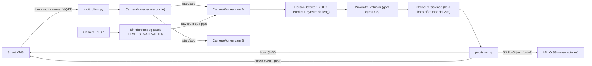
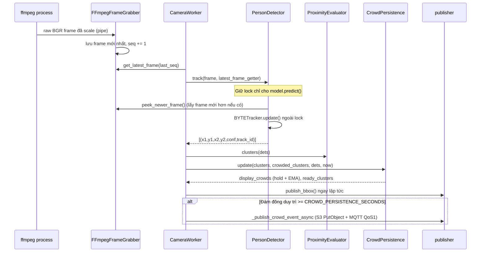

# Báo cáo kỹ thuật: Hệ thống AI Crowd Detection (phát hiện đám đông)

> Tài liệu dành cho developer mới. Đọc xong bạn sẽ nắm được hệ thống làm gì, chạy thế nào, code nằm ở đâu, các luồng xử lý ra sao, **cách đọc chính xác từng con số trong log `Pipeline performance`** và cách điều chỉnh mọi tham số trong `src/config.py`.

---

## Mục lục

1. [Tổng quan](#1-tổng-quan)
2. [Công nghệ sử dụng](#2-công-nghệ-sử-dụng)
3. [Cấu trúc thư mục](#3-cấu-trúc-thư-mục)
4. [Kiến trúc tổng thể](#4-kiến-trúc-tổng-thể)
5. [Chi tiết từng module](#5-chi-tiết-từng-module)
6. [Giao tiếp MQTT với VMS](#6-giao-tiếp-mqtt-với-vms)
7. [Cấu hình và điều chỉnh tham số (`src/config.py` & `.env`)](#7-cấu-hình-và-điều-chỉnh-tham-số-srcconfigpy--env)
8. [Cài đặt và chạy](#8-cài-đặt-và-chạy)
9. [Logging, cách đọc chi tiết chỉ số Performance và Debug](#9-logging-cách-đọc-chi-tiết-chỉ-số-performance-và-debug)
10. [Các lỗi thường gặp](#10-các-lỗi-thường-gặp)
11. [Bài học từ quá trình tối ưu](#11-bài-học-từ-quá-trình-tối-ưu)

---

## 1. Tổng quan

Đây là một **AI service chạy nền**, tích hợp với hệ thống **Smart VMS** (Video Management System). Service này:

1. **Nhận danh sách camera** từ VMS qua MQTT: camera nào bật module `CROWD_DETECTION` thì service xử lý camera đó.
2. **Đọc luồng RTSP** của từng camera theo thời gian thực qua tiến trình `ffmpeg` độc lập.
3. **Phát hiện người** bằng YOLO (`PersonDetector`) và **gán ID theo dõi** (tracking) bằng ByteTrack riêng theo từng camera.
4. **Gom cụm** những người đứng gần nhau (theo khoảng cách chân, có bù phối cảnh) bằng DFS.
5. **Ổn định (hold + làm mượt EMA) và gửi bbox realtime** lên VMS để vẽ đè lên video, **mỗi frame một lần**.
6. Nếu một cụm có **≥ N người** và tồn tại **liên tục ≥ T giây**, service **vẽ khung đám đông lên ảnh snapshot, upload thẳng lên MinIO S3** rồi **gửi sự kiện cảnh báo** (`CROWD_DETECTION`, kèm mức độ `severity`) lên VMS qua MQTT.

Hai loại dữ liệu gửi lên VMS:

| Loại | Tần suất | MQTT QoS | Mục đích |
| :--- | :--- | :--- | :--- |
| **BBox realtime** | Mỗi frame hoàn tất vòng lặp AI | 0 (fire-and-forget) | Vẽ khung người (xanh) & khung đám đông (đỏ) lên video Web VMS |
| **Crowd event** | Khi đám đông duy trì đủ `CROWD_PERSISTENCE_SECONDS` (có lặp lại) | 1 (có ACK từ broker) | Cảnh báo, lưu lịch sử, kèm ảnh snapshot từ MinIO S3 |

---

## 2. Công nghệ sử dụng

| Thành phần | Công nghệ | Vai trò |
| :--- | :--- | :--- |
| Ngôn ngữ | Python 3.11+ | |
| Phát hiện người | [Ultralytics YOLO](https://docs.ultralytics.com/) (hiện trỏ tới `24_nov.pt` trong `src/config.py`) | Detect class `person` |
| Tracking | ByteTrack (`ultralytics.trackers.byte_tracker.BYTETracker`, `bytetrack.yaml`) | Gán `track_id` ổn định độc lập theo từng camera (chạy ngoài lock GPU) |
| Runtime suy luận | PyTorch (CUDA/CPU), có hỗ trợ TensorRT (`.engine`) và OpenVINO | Chọn tự động theo phần cứng |
| Đọc video | **FFmpeg/FFprobe** chạy tiến trình con (`subprocess`) | Giải mã RTSP (H.264/HEVC) sang raw BGR và scale giảm tải theo `FFMPEG_MAX_WIDTH` |
| Xử lý ảnh | OpenCV (`cv2`), NumPy | Vẽ khung snapshot, encode JPEG, tính toán ma trận lân cận |
| Messaging | MQTT qua **WebSockets** (`paho-mqtt`, CallbackAPIVersion 2) | Nhận danh sách camera, gửi bbox và event |
| Lưu trữ ảnh | **MinIO S3** (`boto3`, AWS Signature V4, `PutObject`) | Upload trực tiếp ảnh snapshot JPEG lên bucket `vms-captures` |
| Cấu hình | `python-dotenv` + `src/config.py` | `.env` chứa thông tin kết nối/secret, `src/config.py` chứa toàn bộ tham số AI |

**Yêu cầu hệ thống:** `ffmpeg` và `ffprobe` phải có trong `PATH`. Nếu thiếu, camera sẽ không đọc được frame.

---

## 3. Cấu trúc thư mục

```text
crowded_detection/
├── main.py                  # Entry point: khởi tạo log, kết nối MQTT, chạy vòng lặp
├── requirements.txt         # Danh sách thư viện Python cần cài (UTF-8)
├── .env                     # Thông tin kết nối (MQTT, Zone, Org, MinIO S3) - KHÔNG commit
├── .env.example             # File mẫu cho .env
├── PROJECT_REPORT.md        # Tài liệu kỹ thuật hệ thống & hướng dẫn đọc performance/tinh chỉnh
├── VMS_INTEGRATION_DOCS.md  # Tài liệu chuẩn giao thức MQTT & MinIO S3 với Smart VMS
├── src/
│   ├── config.py            # Nơi duy nhất chứa tham số AI/FFmpeg/Crowd/BBox/Debug
│   ├── setup_logging.py     # Cấu hình log (file xoay vòng + console), che mật khẩu trong URL
│   ├── mqtt_client.py       # Tạo MQTT client, subscribe topic camera, quản lý worker
│   ├── camera_manager.py    # Parse danh sách camera, so sánh và start/stop worker
│   ├── camera_worker.py     # Đọc RTSP (FFmpeg), vòng lặp AI, hold bbox, gửi bbox & crowd event
│   ├── detector.py          # YOLO predict() dùng chung lock + BYTETracker chạy riêng từng camera
│   ├── analyze.py           # ProximityEvaluator: tính lân cận và gom cụm DFS
│   └── publisher.py         # Upload ảnh MinIO S3 (boto3), publish crowd event & bbox
├── scripts/
│   ├── test_publisher.py    # Test upload S3 + gửi thử Crowd Event qua MQTT lên VMS
│   ├── test_model_performance.py # Test tốc độ & bbox của model YOLO trên file video
│   ├── extract_frame.py     # Tách frame từ video để gán nhãn/kiểm thử
│   └── train_yolov8.py      # Script huấn luyện model YOLO
├── resources/
│   ├── runs/train/          # Kết quả train: weights/ (best.pt, final.pt, ...), args.yaml, results.csv
│   ├── dataset_yolo/        # Dataset huấn luyện (data.yaml, split.json)
│   ├── cvat_export/         # Frame xuất từ CVAT để gán nhãn/kiểm thử
│   ├── recordings/          # Video ghi lại từ camera để test
│   ├── img_test/            # (tự tạo) Ảnh debug khi bật DEBUG_FRAME_SAVE_ENABLED
│   └── debug_videos/        # (tự tạo) Video debug khi bật DEBUG_VIDEO_ENABLED
└── logs/
    └── app.log              # Log chạy (xoay vòng 5MB x 3 file)
```

---

## 4. Kiến trúc tổng thể

### 4.1. Sơ đồ thành phần



### 4.2. Mô hình luồng (thread / process)

| Luồng | Số lượng | Việc làm |
| :--- | :--- | :--- |
| Main thread | 1 | `client.loop_forever()`: xử lý mạng MQTT, callback |
| `camera-reconcile` | 1 mỗi lần nhận cấu hình | Parse payload, start/stop worker (tránh chặn thread MQTT) |
| `camera-<code>` | 1 mỗi camera | Vòng lặp AI: lấy frame, YOLO + ByteTrack, gom cụm, hold bbox, publish |
| `rtsp-<code>` | 1 mỗi camera | Đọc raw frame từ stdout của ffmpeg vào bộ nhớ |
| `rtsp-watch-<code>` | 1 mỗi camera | Watchdog: kill ffmpeg nếu stream treo |
| Tiến trình `ffmpeg` | 1 mỗi camera | Kết nối RTSP, giải mã & thu nhỏ video theo `FFMPEG_MAX_WIDTH`, chạy ngoài Python |
| `crowd-event-<code>` | tạm thời (khi có sự kiện) | Upload ảnh S3 và publish event QoS 1, không chặn vòng lặp AI |

**Chia sẻ model và tách biệt tracker:**
- Tất cả camera dùng chung 1 instance `YOLO` (cache trong `_SHARED_MODELS`) để tiết kiệm RAM/VRAM.
- Khóa `_MODEL_INFERENCE_LOCK` và `_INFERENCE_SEMAPHORE` (`MAX_CONCURRENT_INFERENCES`) **chỉ bọc bước `self._model.predict()`** (suy luận GPU/CPU).
- Mỗi `PersonDetector` sở hữu một instance `BYTETracker` độc lập (`self._tracker`), chạy **bên ngoài lock** trên CPU sau khi đã có kết quả detect — vừa triệt để tránh lỗi race condition `'DetectionPredictor' object has no attribute 'trackers'`, vừa giảm thời gian giữ khóa GPU.

### 4.3. Luồng xử lý một frame



---

## 5. Chi tiết từng module

### 5.1. [`main.py`](main.py): entry point

- Gọi `setup_logging()`, in banner khởi động.
- `build_client()` tạo MQTT client, `connect()` rồi `loop_forever()`.
- Khi `Ctrl+C`: ngắt MQTT và gọi `stop_camera_workers()` để dừng mọi camera.

### 5.2. [`src/config.py`](src/config.py): cấu hình tập trung

- Đọc `.env` cho **thông tin kết nối và khóa bí mật** (`MODULE`, `ZONE_ID`, `ORG_ID`, `MQTT_*`, `VMS_S3_*`).
- Mọi **tham số AI, FFmpeg, đám đông, bbox, debug** được khai báo **trực tiếp trong file này** kèm chú thích tác dụng ngay trên từng dòng (chỉ có một nguồn sự thật, tránh sửa nhầm chỗ).
- Cuối file có phần **validate**: nếu giá trị sai (âm, bằng 0, sai enum, ngưỡng `MEDIUM >= HIGH`) thì service dừng ngay lúc khởi động.

Chi tiết từng tham số xem tại [mục 7](#7-cấu-hình-và-điều-chỉnh-tham-số-srcconfigpy--env).

### 5.3. [`src/mqtt_client.py`](src/mqtt_client.py): kết nối và điều phối

- Transport **WebSockets**, path `MQTT_PATH`, TLS theo `MQTT_TLS_ENABLED`.
- Tự reconnect (`reconnect_delay_set(1..30s)`). Khi `on_connect` nhận `reason_code != 0`, chỉ ghi log lỗi và return (không gọi `client.disconnect()` để `paho-mqtt` tự thử kết nối lại).
- `on_connect`: subscribe `smart_vms/cameras/zone/{ZONE_ID}` (QoS 1).
- `on_message`: payload được đưa sang thread `camera-reconcile` (có `reconcile_lock`) để không làm chặn thread mạng MQTT.
- `stop_camera_workers()`: gửi `signal_stop()` cho **tất cả** worker trước, rồi mới `join` từng cái.

### 5.4. [`src/camera_manager.py`](src/camera_manager.py): reconcile danh sách camera

- Chỉ lấy camera có `ai_modules` chứa `MODULE` (`CROWD_DETECTION`).
- URL RTSP ưu tiên `restream_urls[MODULE]`, nếu không có mới lấy `rtsp_url`.
- Tự động Start camera mới, Stop camera bị tắt, và Stop → Start lại nếu `id` hoặc `rtsp_url` thay đổi.

### 5.5. [`src/camera_worker.py`](src/camera_worker.py): trái tim của hệ thống

#### a) `probe_stream()` và `FFmpegFrameGrabber`: đọc RTSP độ trễ thấp & scale giảm tải

**Nguyên lý:**
- Khi kết nối lần đầu, `_ensure_dimensions()` gọi `probe_stream()` (chạy `ffprobe` 1 lần duy nhất) để đọc kích thước gốc (`src_w x src_h`) của luồng RTSP.
- Nếu `FFMPEG_MAX_WIDTH > 0` và `src_w > FFMPEG_MAX_WIDTH`, hệ thống tính `target_w`, `target_h` (giữ đúng tỷ lệ khung hình, làm tròn chẵn pixel) và truyền `-vf scale=W:H:flags=fast_bilinear` cho `ffmpeg` thu nhỏ ngay trước khi xuất ra pipe. Nếu camera vốn đã có chiều rộng $\le$ `FFMPEG_MAX_WIDTH`, bỏ hẳn `-vf scale` để không tốn CPU.
- **Lợi ích với luồng 2K (`2688x1520`):** Scale xuống `1280x724` ngay trong FFmpeg giúp giảm **~4.4×** dung lượng frame qua pipe (`12.2 MB → 2.8 MB/frame`), giảm tải cấp phát NumPy/copy bộ nhớ và khớp thẳng với `YOLO_IMGSZ = 1280` (YOLO không phải thu ảnh 2K bên trong lock nữa).
- Grabber dùng tiến trình `ffmpeg` riêng, `-rtsp_transport tcp`, `-threads 2`, `-vsync 0`, xuất `bgr24` qua `pipe:1`, Python đọc zero-copy bằng `readinto()`, **chỉ giữ 1 frame mới nhất** còn tươi trong `max_frame_age = 0.40s`.

> [!IMPORTANT]
> **Vì sao không dùng `cv2.VideoCapture`?** Khi YOLO chiếm CPU/GPU/GIL, `cv2.VideoCapture` để dồn gói tin trong buffer `libavformat`/TCP (vì `CAP_PROP_BUFFERSIZE=1` không xả được hàng đợi mạng trên backend FFmpeg RTSP), làm frame cũ đi 0.5–2 giây và bbox bị trễ pha. Tách tiến trình `ffmpeg` riêng kết hợp `max_frame_age` giải quyết triệt để độ trễ này.

#### b) `CrowdPersistence` & ổn định bbox đỏ khi người rìa cụm ra vào (hold-only)

`CrowdPersistence.update(clusters, crowded_clusters, detections, now, frame_interval_s)` vừa quản lý bộ đếm gửi cảnh báo `20s`, vừa hậu xử lý để **chống nhấp nháy bbox đỏ khi người rìa cụm ra vào**:

1. **Hiển thị ngay khi đạt ngưỡng:** Khi một cụm có $\ge$ `NUMBER_PERSON_IS_CROWDED` (5 người), hệ thống cấp `crowd_id` ổn định và đưa ngay vào `display_crowds` (không có độ trễ chờ).
2. **Hold bbox đỏ khi người rìa tạm tách (`CROWD_BBOX_HOLD_SECONDS = 3.0s`):**
   - Nếu ở frame tiếp theo 1 người rìa bước ra khiến cụm DFS tụt xuống 4 người (`crowded_clusters` tạm mất cụm đó), `CrowdPersistence` tìm cụm con lõi còn lại ($\ge 2$ người, khớp `track_id` / IoU / tâm) trong `clusters`:
     - Tiếp tục giữ bbox đỏ `crowd_<id>` trong tối đa `CROWD_BBOX_HOLD_SECONDS` (hoặc `2.5 × frame_interval_s` nếu FPS rất thấp).
     - Giữ nguyên `member_indices` của nhóm lõi để **không vẽ đè các bbox xanh đơn lẻ bên trong khung đỏ đang hold**.
     - Người đi tách ra ngoài vẫn hiện bbox xanh đơn lẻ như bình thường.
   - Nếu quá `CROWD_BBOX_HOLD_SECONDS` mà cụm không đạt lại `NUMBER_PERSON_IS_CROWDED` người, bbox đỏ tự tắt và trả lại bbox xanh cho từng người.
3. **Làm mượt tọa độ EMA (`CROWD_BBOX_SMOOTHING_ALPHA = 0.35`):** Hàm `_smooth_bbox()` làm mượt 4 cạnh bbox đỏ giữa các frame liên tiếp (`prev * (1 - alpha) + new * alpha`), giảm hiện tượng khung đỏ co giật khi viền ngoài xê dịch.
4. **Hấp thụ khi 2 đám đông nhập làm 1:** Nếu 2 cụm đã có `crowd_id` tiến sát vào nhau và gộp thành 1 cụm DFS lớn, cụm cũ bị gộp được thu hồi ngay để không tồn tại 2 khung đỏ đè lên nhau.
5. **Chống chết ngầm worker:** Vòng lặp frame trong `CameraWorker._run()` được bọc `try...except Exception:` bên trong `while`, nếu 1 frame gặp sự cố sẽ ghi log rồi tiếp tục chạy chứ không làm dừng vĩnh viễn worker camera đó.

#### c) Quy tắc vẽ bbox trong [`_build_bbox_detections()`](src/camera_worker.py) và [`_annotate_bbox_detections()`](src/camera_worker.py)

- **BBox realtime gửi lên VMS (`_build_bbox_detections`):**
  - Người **nằm trong đám đông đang hiển thị** (`display_crowds`, gồm cả lúc đang hold): **không gửi** bbox đơn lẻ.
  - Người **đứng ngoài đám đông**: gửi bbox đơn lẻ màu xanh (`#00ff00`) nếu `PUBLISH_ALL_PERSON_BBOX = True`.
  - Cụm đám đông (`display_crowds`): gửi 1 bbox đỏ (`#ff0000`, `class: "crowd"`, nới rộng `CROWD_BBOX_PADDING_PERCENT`%) kèm `person_count` và `track_ids`.
- **Ảnh snapshot cảnh báo (`_annotate_bbox_detections`):**
  - Chỉ vẽ các bbox đỏ bao quanh vùng đám đông từ `display_crowds` (đã tắt bbox đơn lẻ từng người và chữ debug trên ảnh để ảnh cảnh báo sạch, rõ ràng).

### 5.6. [`src/detector.py`](src/detector.py): `PersonDetector`

- **Chọn backend (`_select_runtime`):**
  - **TensorRT (`.engine`) tự động trên GPU CUDA:** Khi `YOLO_INFERENCE_BACKEND = "tensorrt"` (và `WEIGHT_YOLO_MODEL_PATH` trỏ tới `<ten_model>.engine` hoặc `<ten_model>.pt`), nếu file `.engine` chưa tồn tại, hệ thống sẽ tự gọi `YOLO(<ten_model>.pt).export(format="engine", imgsz=YOLO_IMGSZ, ...)` **bên trong `_SHARED_MODEL_LOCK`** để build `.engine` khớp đúng GPU/CUDA của máy chạy, giải phóng VRAM PyTorch rồi load `.engine` với `task="detect"`. Nếu export lỗi (thiếu thư viện hoặc OOM), hệ thống tự dọn file `.engine` dở dang và fallback an toàn về PyTorch CUDA.
  - Thứ tự ưu tiên chung: TensorRT CUDA → PyTorch CUDA (`half` theo `YOLO_HALF_PRECISION`) → OpenVINO (CPU/iGPU Intel nếu có thư mục model OpenVINO) → PyTorch CPU.
- **Định cấu hình CPU thread:** `_configure_torch_runtime()` và `_restore_torch_runtime()` áp dụng `torch.set_num_threads(cf.YOLO_CPU_THREADS)` cho **cả máy CPU lẫn máy có GPU CUDA** (tránh PyTorch tự bung 20+ thread CPU làm nghẽn FFmpeg).
- **Tách inference và tracking:**
  - `self._model.predict(..., imgsz=..., conf=..., iou=cf.YOLO_MODEL_IOU, ...)` chạy bên trong `with _INFERENCE_SEMAPHORE, _MODEL_INFERENCE_LOCK:`.
  - Ngay sau khi nhả khóa, `self._tracker.update(det_boxes, frame)` (instance `BYTETracker` riêng của từng camera) chạy trên CPU để gán `track_id`. Các camera không còn phải chờ nhau khi chạy tracking và không thể xóa/trộn state `predictor.trackers` của nhau.

### 5.7. [`src/analyze.py`](src/analyze.py): `ProximityEvaluator` (gom cụm)

- Điểm chân: `foot = ((x1 + x2) / 2, y2)`
- Chiều dài cơ thể: `L = max(w, h)` (mode `max`) hoặc `L = h` (mode `height`)
- Khoảng cách bù phối cảnh trục y: `d(i,j) = sqrt( (fx_i - fx_j)^2 + (y_scale * (fy_i - fy_j))^2 )`
- Ngưỡng lân cận: `thr(i,j) = alpha * (L_i + L_j) / 2`
- Dựng ma trận kề `N x N` bằng NumPy và tìm thành phần liên thông bằng DFS.

### 5.8. [`src/publisher.py`](src/publisher.py): gửi dữ liệu & MinIO S3

- `publish_bbox(...)`: QoS 0 qua MQTT WebSocket, khóa bằng `_MQTT_PUBLISH_LOCK`.
- `_get_s3_client()`: khởi tạo `boto3.client("s3")` dạng lazy-init (chỉ tạo khi upload lần đầu, dùng AWS SigV4, `addressing_style="path"`, connect timeout `5s`, read timeout `15s`, retry `3` lần).
- `upload_snapshot(jpg, camera_id, category="crowd")`: đặt key theo chuẩn giờ VN `crowd/{YYYY-MM-DD}/camera_{camera_id}/{uuid}.jpg`, gọi `PutObject` lên bucket `VMS_S3_BUCKET`.
- `_crowd_severity(person_count)`: tính mức độ cảnh báo dựa theo cụm lớn nhất (`>= CROWD_SEVERITY_HIGH_MIN_PERSONS` → `"HIGH"`, `>= CROWD_SEVERITY_MEDIUM_MIN_PERSONS` → `"MEDIUM"`, còn lại `"LOW"`).
- `publish_crowd_event(...)`: upload ảnh lên S3 trước, có `object_key` mới publish bản tin event lên `smart_vms/ai_events/{MODULE}` (QoS 1, chờ ACK tối đa 5s).

### 5.9. [`src/setup_logging.py`](src/setup_logging.py)

- Ghi ra `logs/app.log` (xoay vòng 5MB × 3 bản) và console, level lấy từ `LOG_LEVEL`.
- Filter `MaskCredentials` tự che `user:pass` trong URL RTSP ở mọi dòng log.

---

## 6. Giao tiếp MQTT với VMS

### 6.1. Bảng topic

| Hướng | Topic | QoS | Nội dung |
| :--- | :--- | :--- | :--- |
| VMS → AI | `smart_vms/cameras/zone/{ZONE_ID}` | 1 | Danh sách camera của zone (retained) |
| AI → VMS | `smart_vms/ai/bbox/{camera_code}` | 0 | BBox realtime |
| AI → VMS | `smart_vms/ai_events/{MODULE}` | 1 | Sự kiện đám đông |

### 6.2. Payload gửi: Crowd event (giao thức MinIO S3 mới)

```json
{
  "ai_modules": "CROWD_DETECTION",
  "submodule_code": "CROWD_DETECTION",
  "camera_id": "6aee1244-632d-43e3-8ef4-447ad539277a",
  "camera_code": "nhatron-loira",
  "event_time": "2026-11-25T20:30:00+07:00",
  "event_type": "CROWD_DETECTION",
  "entity_type": "PERSON",
  "severity": "MEDIUM",
  "payload": {
    "type": "HIGH_DENSITY",
    "person_count": 6,
    "threshold": 5,
    "clusters": [
      { "cluster_id": 1, "person_count": 6, "detections": [0,1,2,3,4,5], "track_ids": [1,2,3,5,7,9] }
    ]
  },
  "snapshot_url": "crowd/2026-11-25/camera_6aee1244-632d-43e3-8ef4-447ad539277a/a0782800f256....jpg"
}
```

Chi tiết đầy đủ về giao thức S3, quy ước key và cách test xem thêm tại [`VMS_INTEGRATION_DOCS.md`](VMS_INTEGRATION_DOCS.md).

---

## 7. Cấu hình và điều chỉnh tham số (`src/config.py` & `.env`)

> [!IMPORTANT]
> **Quy tắc:** `.env` chỉ chứa **thông tin kết nối và secret**. Toàn bộ tham số thuật toán, AI, FFmpeg, Crowd, BBox, Debug chỉnh trực tiếp trong [`src/config.py`](src/config.py). Mỗi biến trong [`src/config.py`](src/config.py) đều có comment ngắn giải thích tác dụng ngay trên dòng khai báo. Sửa xong cần **khởi động lại service**.

### 7.1. Biến môi trường trong `.env`

| Biến | Bắt buộc | Ví dụ | Tác dụng |
| :--- | :---: | :--- | :--- |
| `MODULE` | ✔ | `CROWD_DETECTION` | Tên module AI trên VMS (dùng lọc camera & đặt tên topic event) |
| `ZONE_ID` | ✔ | `289` | ID Zone để lắng nghe danh sách camera |
| `ORG_ID` | ✔ | `115` | ID tổ chức gửi kèm payload BBox |
| `MQTT_HOST` / `MQTT_PORT` / `MQTT_PATH` | ✔ | `192.168.1.250` / `19048` / `/mqtt` | Broker MQTT over WebSocket |
| `MQTT_USER` / `MQTT_PASS` | ✔ | | Tài khoản đăng nhập MQTT Broker |
| `MQTT_CLIENT_ID` | ✔ | `phan_van_quan` | **Phải duy nhất**; 2 process trùng ID sẽ đá nhau liên tục |
| `VMS_S3_ENDPOINT` | | `http://192.168.1.250:18646` | Endpoint MinIO S3 upload ảnh |
| `VMS_S3_BUCKET` | | `vms-captures` | Tên bucket chứa ảnh |
| `VMS_S3_ACCESS_KEY` / `VMS_S3_SECRET_KEY` | | `atin` / `<secret>` | Key xác thực MinIO (policy `edge-ai-writer`) |

### 7.2. Nhóm Model AI, FFmpeg & Inference (`src/config.py` mục 2)

| Tham số | Giá trị hiện tại | Tác dụng & Hướng điều chỉnh |
| :--- | :--- | :--- |
| `WEIGHT_YOLO_MODEL_PATH` | `./resources/runs/train/weights/24_nov.pt` | Đường dẫn weights YOLO (`.pt` hoặc `.engine`). Khi đặt `<ten_model>.engine` và bật `YOLO_INFERENCE_BACKEND = "tensorrt"`, nếu chưa có file `.engine` hệ thống sẽ tự convert từ `<ten_model>.pt` cùng thư mục ngay trên GPU máy chạy. Khi đổi `YOLO_IMGSZ` hoặc đổi GPU, hãy xóa file `.engine` cũ để tự export lại. |
| `OPENVINO_MODEL_PATH` | `./resources/runs/train/weights/final_openvino_model` | Thư mục model OpenVINO (chỉ dùng khi máy không có GPU CUDA). |
| `YOLO_INFERENCE_BACKEND` | `"auto"` | Chọn runtime: `"auto"`, `"pytorch"`, `"cuda"`, `"openvino"`, `"tensorrt"`. Đổi sang `"tensorrt"` trên máy CUDA để hệ thống dùng (hoặc tự export lần đầu từ `.pt`) file `.engine` giúp tăng mạnh FPS. |
| `YOLO_OPENVINO_DEVICE` | `"intel:cpu"` | Thiết bị chạy OpenVINO (`"intel:cpu"`, `"intel:gpu"`, `"auto"`). |
| `YOLO_IMGSZ` | `1280` | Kích thước cạnh ảnh đưa vào YOLO. **Tăng** (`1280`): bắt người ở xa/nhỏ tốt hơn nhưng inference nặng hơn rõ rệt. **Giảm** (`960` / `640`): tăng FPS nhanh nhưng dễ sót người nhỏ ở xa. |
| `YOLO_HALF_PRECISION` | `True` | Dùng FP16 trên GPU NVIDIA (nhanh hơn và tốn ít VRAM hơn FP32). Không có tác dụng trên CPU. |
| `YOLO_MODEL_CONF` | `0.7` | Ngưỡng tin cậy detect `person`. **Tăng** (`0.7`+): rất ít nhận nhầm vật thể nhưng dễ sót người đứng xa/bị che. **Giảm** (`0.5`–`0.6`): bắt nhạy hơn nhưng dễ có box nhiễu. |
| `YOLO_MODEL_IOU` | `0.7` | Ngưỡng IoU cho NMS loại bỏ box chồng lấn. **Giảm** (`0.5`–`0.6`): lọc gắt hơn, ít bị tình trạng 1 người tách ra 2 box đếm dư thành đám đông giả. |
| `YOLO_CPU_THREADS` | `6` | Số luồng CPU cấp cho PyTorch (áp dụng cho cả CPU lẫn GPU). Đặt vừa đủ (`<=` số nhân vật lý trừ phần cho FFmpeg) để tránh tranh chấp CPU. |
| `MAX_CONCURRENT_INFERENCES` | `1` | Số luồng suy luận `model.predict()` tối đa cùng lúc. Để `1` để tránh tranh chấp lock GPU giữa nhiều camera. |
| `FFMPEG_MAX_WIDTH` | `1280` | Giới hạn chiều rộng tối đa đầu ra của FFmpeg (`0` = giữ nguyên gốc). Với camera 2K/4K (`2688×1520`), đặt `1280` giảm ~4.4× dung lượng copy qua pipe và khớp thẳng với `YOLO_IMGSZ = 1280` mà không mất nét. |

### 7.3. Nhóm Đánh giá khoảng cách & Đám đông (`src/config.py` mục 3)

| Tham số | Giá trị hiện tại | Tác dụng & Hướng điều chỉnh |
| :--- | :--- | :--- |
| `PROXIMITY_ALPHA` | `2.0` | Hệ số khoảng cách đứng gần: `ngưỡng = alpha × chiều_dài_cơ_thể_TB`. **Tăng**: người đứng hơi thưa vẫn gom thành cụm; **Giảm** (`1.3`–`1.6`): phải đứng sát nhau mới gom. |
| `PROXIMITY_Y_SCALE` | `1.9` | Hệ số kéo giãn trục dọc Y để bù góc nghiêng camera. Camera lắp cao nhìn chéo mạnh → đặt lớn (`1.6`–`2.2`); camera nhìn từ trên thẳng xuống → gần `1.0`. |
| `PROXIMITY_LENGTH_MODE` | `"max"` | Cách đo kích thước người: `"max"` (`max(w, h)`) ổn định khi người ngồi/cúi; `"height"` (`h`) chặt hơn khi người đứng thẳng. |
| `NUMBER_PERSON_IS_CROWDED` | `5` | Số người tối thiểu trong 1 cụm liên thông để tính là đám đông. |
| `CROWD_PERSISTENCE_SECONDS` | `20.0` | Đám đông phải duy trì liên tục đủ số giây này mới chụp snapshot upload S3 và bắn sự kiện cảnh báo lên VMS. Tăng để chống báo giả; giảm để cảnh báo sớm hơn. |
| `CROWD_TRACK_GRACE_SECONDS` | `3.5` | Thời gian chịu mất dấu (giây) cho bộ đếm sự kiện `20s`. Nếu đám đông bị rớt detection ngắn hơn ngưỡng này rồi có lại, đồng hồ `20s` không bị reset về 0. |
| `CROWD_SPATIAL_IOU_THRESHOLD` | `0.25` | Độ chồng lấp IoU tối thiểu giữa 2 frame để khớp cùng một đám đông (khi `track_id` bị đổi). |
| `CROWD_CENTER_DISTANCE_RATIO` | `0.8` | Tỉ lệ khoảng cách tâm / kích thước cụm tối đa để vẫn coi là cùng 1 cụm giữa 2 frame. |
| `CROWD_EVENT_REPEAT_INTERVAL_SECONDS` | `180.0` | Chu kỳ (giây) gửi lặp lại sự kiện lên VMS nếu đám đông vẫn tồn tại sau lần báo đầu tiên. |
| `CROWD_BBOX_PADDING_PERCENT` | `10.0` | Phần trăm mở rộng 4 cạnh bbox đỏ bao quanh cụm đám đông để viền khung không cắt sát người. |
| `CROWD_SEVERITY_MEDIUM_MIN_PERSONS` | `5` | Số người trong cụm lớn nhất $\ge$ ngưỡng này đánh mức `severity = "MEDIUM"`. |
| `CROWD_SEVERITY_HIGH_MIN_PERSONS` | `10` | Số người trong cụm lớn nhất $\ge$ ngưỡng này đánh mức `severity = "HIGH"`. |

### 7.4. Nhóm BBox Realtime lên Web VMS (`src/config.py` mục 4)

| Tham số | Giá trị hiện tại | Tác dụng & Hướng điều chỉnh |
| :--- | :--- | :--- |
| `PUBLISH_ALL_PERSON_BBOX` | `True` | `True`: gửi bbox xanh cho các cá nhân đứng ngoài đám đông. `False`: bình thường không gửi khung xanh, chỉ gửi khung đỏ khi có đám đông. |
| `CROWD_BBOX_HOLD_SECONDS` | `3.0` | Thời gian giữ ổn định bbox đỏ (giây) khi một người ở rìa đám đông tạm di chuyển ra ngoài làm cụm tụt dưới `NUMBER_PERSON_IS_CROWDED`. Giúp khung đỏ không chớp tắt liên tục sang khung xanh. Đặt `0.0` nếu muốn tắt hold. |
| `CROWD_BBOX_SMOOTHING_ALPHA` | `0.35` | Hệ số làm mượt EMA (`0 < alpha <= 1.0`) cho 4 tọa độ của bbox đỏ. **Giảm** (`0.2`–`0.3`) khung chuyển động êm hơn nhưng bám chậm hơn chút khi cả đám di chuyển nhanh; đặt `1.0` để tắt làm mượt. |

### 7.5. Nhóm Log & Debug (`src/config.py` mục 5)

| Tham số | Giá trị hiện tại | Tác dụng & Hướng điều chỉnh |
| :--- | :--- | :--- |
| `LOG_LEVEL` | `"INFO"` | `"DEBUG"`, `"INFO"`, `"WARNING"`, `"ERROR"`. Bật `"DEBUG"` khi cần soi chi tiết lỗi publish BBox QoS 0. |
| `DEBUG_VIDEO_ENABLED` | `False` | `True` để ghi video `.mp4` debug vào `resources/debug_videos/` (**tốn CPU encode video, luôn tắt trên Production**). |
| `DEBUG_FRAME_SAVE_ENABLED` | `False` | `True` để lưu ảnh JPEG mỗi 5 giây vào `resources/img_test/`. |
| `DEBUG_VIDEO_FPS` | `10.0` | FPS khai báo cho file video debug. |
| `DEBUG_MAX_SAVED_FRAMES` / `DEBUG_MAX_SAVED_VIDEOS` | `200` / `10` | Giới hạn số lượng file debug giữ lại trên ổ đĩa (tự động xóa file cũ nhất). |

### 7.6. Gợi ý tinh chỉnh nhanh theo tình huống thực tế

| Tình huống | Tham số nên chỉnh |
| :--- | :--- |
| Sót người ở xa hoặc mặc áo tối màu | Giảm `YOLO_MODEL_CONF` (`0.7` → `0.55`–`0.6`), giữ `YOLO_IMGSZ = 1280` |
| 1 người tách thành 2 bbox gây đếm nhầm thành đám đông | Giảm `YOLO_MODEL_IOU` (`0.7` → `0.55`) |
| Người đứng cách khá xa vẫn bị gom thành 1 đám đông | Giảm `PROXIMITY_ALPHA` (`2.0` → `1.6`) hoặc tăng `PROXIMITY_Y_SCALE` |
| BBox đỏ chớp tắt khi có 1 người lượn ở rìa cụm 5 người | Tăng `CROWD_BBOX_HOLD_SECONDS` (`3.0` → `4.0`) |
| BBox đỏ hơi rung cạnh dù người đứng yên | Giảm `CROWD_BBOX_SMOOTHING_ALPHA` (`0.35` → `0.25`) |
| Cần tăng FPS lên 12–14+ FPS khi chạy nhiều camera cùng lúc | Dùng TensorRT (`YOLO_INFERENCE_BACKEND = "tensorrt"`), đảm bảo `FFMPEG_MAX_WIDTH = 1280`, hoặc hạ `YOLO_IMGSZ` (`1280` → `960`) |

---

## 8. Cài đặt và chạy

```bash
# 1. Kiểm tra FFmpeg & FFprobe
ffmpeg -version && ffprobe -version

# 2. Cài thư viện từ requirements.txt (trong virtualenv Python 3.11+)
pip install -r requirements.txt

# 3. Sao chép và điền thông số kết nối vào .env
cp .env.example .env

# 4. Kiểm tra kết nối S3 + MQTT trước khi chạy chính thức
python scripts/test_publisher.py --people 6

# 5. Chạy hệ thống
python main.py
```

---

## 9. Logging, cách đọc chi tiết chỉ số Performance và Debug

### 9.1. Giải phẫu một dòng log `Pipeline performance` (kèm ví dụ thực tế)

Mỗi **5 giây** (`PERFORMANCE_LOG_INTERVAL_S = 5.0`), mỗi camera worker sẽ ghi ra 1 dòng tổng kết hiệu năng trong [`logs/app.log`](logs/app.log) và console:

```text
2026-11-25 20:15:10,123 | INFO | camera-san-cot-co | camera_worker | Pipeline performance camera=san-cot-co frames=27 fps=5.38 cpu_threads=6 bbox_publish_ok=27/27 stage_avg/max_ms=[read=2/14ms infer=181/210ms cluster=0/1ms crowd=0/1ms bbox_build=0/0ms bbox_publish=1/3ms annotate=0/0ms snapshot_encode=n/a snapshot_write=0/0ms video_write=0/0ms loop=185/215ms]
```

Hãy bóc tách từng câu hỏi quan trọng nhất khi nhìn vào dòng log này:

#### Câu hỏi 1: `frames=27` là gì?
- Là **số frame đã hoàn tất trọn vẹn cả vòng lặp xử lý AI** (đọc → infer → gom cụm → hold → publish bbox) cho riêng camera `san-cot-co` trong **chu kỳ ~5 giây vừa qua** (sau khi in log xong, biến đếm `frame_count` được reset về `0` cho chu kỳ 5 giây tiếp theo).
- **Đây KHÔNG phải số frame do camera gửi về hay do FFmpeg giải mã.** Ví dụ: camera phát ở `20 FPS` (tức trong 5 giây FFmpeg giải mã ra `100` frame), nhưng luồng AI chỉ kịp xử lý `27` frame (với `FFmpegFrameGrabber` luôn bỏ qua `73` frame cũ để lấy đúng frame mới nhất), thì log sẽ in `frames=27`.

#### Câu hỏi 2: `fps=5.38` đo trên cái gì (toàn bộ pipeline AI hay chỉ reader)?
- **`fps` là tốc độ xử lý của TOÀN BỘ PIPELINE AI ENGINE cho camera đó**, **không phải** FPS của FFmpeg reader.
- Công thức trong [`src/camera_worker.py`](src/camera_worker.py):
  ```python
  fps = frame_count / elapsed   # Ví dụ: 27 frame / 5.02 giây = 5.38 FPS
  ```
- Nói cách khác, **`fps=5.38` cũng chính là số lần thực tế gửi BBox lên Web VMS mỗi giây** cho camera đó (`bbox_publish_ok=27/27` trong 5.02 giây).

#### Câu hỏi 3: Các chỉ số `stage_avg/max_ms=[...]` được đo thế nào? Ví dụ `infer=181/210ms` nghĩa là gì?

**Cách đo trong code:**
Ở mỗi frame trong vòng lặp `CameraWorker._run()`, hệ thống dùng `time.perf_counter()` đo thời gian thực thi của từng bước tính bằng mili-giây (`ms`), cộng dồn vào `stage_totals_ms[stage]` và cập nhật đỉnh `stage_max_ms[stage]`. Cuối chu kỳ 5 giây, log in ra cho mỗi công đoạn theo định dạng **`TRUNG_BÌNH/LỚN_NHẤTms`**:
- **Số bên trái (`avg`)** = `stage_totals_ms[stage] / frame_count` (trung bình cộng trên toàn bộ `frames` trong 5 giây).
- **Số bên phải (`max`)** = `max(tất cả các frame trong 5 giây)` (frame chậm nhất đơn lẻ trong 5 giây đó).

**Giải thích cụ thể ví dụ `infer=181/210ms` (trên `frames=27`):**
- **`181ms` (trung bình):** Trong 27 frame vừa qua, trung bình mỗi lần gọi `detector.track(frame)` mất `181ms`. Lưu ý cực quan trọng là thời gian `infer` này **bao gồm cả 3 thành phần**:
  1. **Thời gian xếp hàng chờ khóa `_MODEL_INFERENCE_LOCK`** (khi có nhiều camera cùng chạy trên 1 GPU với `MAX_CONCURRENT_INFERENCES = 1`).
  2. **Thời gian thực tế GPU/CPU chạy `self._model.predict()`** (tiền xử lý + forward YOLO + NMS).
  3. **Thời gian chạy `self._tracker.update()`** (`BYTETracker` trên CPU, thường chỉ `~1–3ms` sau khi đã tách ra ngoài lock).
- **`210ms` (max):** Trong 27 frame đó, frame chạm đỉnh chậm nhất ở bước `infer` mất `210ms`.
- **Cách đọc chênh lệch `avg` vs `max`:**
  - `181/210ms` (hai số sát nhau): tốc độ chậm nhưng **rất đều**, tức là GPU đang gánh tải ổn định (ví dụ: GPU bị chia cho nhiều camera hoặc bị tiến trình train chiếm VRAM/compute, hoặc `YOLO_IMGSZ=1280` nặng).
  - `45/850ms` (`max` vọt gấp hàng chục lần `avg`): bình thường rất nhanh (`45ms` ≈ 22 FPS), thỉnh thoảng mới khựng 1 frame (`850ms`) — dấu hiệu vừa khởi tạo CUDA lần đầu hoặc có tiến trình khác tranh CPU/GPU thoáng qua.

**Ví dụ tính nhẩm tổng `loop` & tại sao 4 camera chia GPU làm `infer` tăng gấp 4:**
- Trong dòng log ví dụ trên:
  `read (2ms) + infer (181ms) + cluster (0ms) + crowd (0ms) + bbox_build (0ms) + bbox_publish (1ms) ≈ 184ms ≈ loop=185ms`
  $\rightarrow$ Tốc độ suy luận dự kiến: `1000 / 185 ≈ 5.40 FPS` (khớp với `fps=5.38`!).
- Giả sử GPU chạy `model.predict()` hết `45ms` cho 1 frame:
  - Khi chạy **1 camera**: `infer ≈ 45ms` $\rightarrow$ đạt `~20 FPS`.
  - Khi chạy **4 camera cùng lúc**: vì dùng chung GPU (`MAX_CONCURRENT_INFERENCES = 1`), camera A phải chờ GPU phục vụ xong cho B, C, D (`3 × 45ms = 135ms` chờ lock + `45ms` tự chạy = **`180ms`**) $\rightarrow$ log mỗi camera sẽ in **`infer ≈ 180ms` (`~5.5 FPS / camera`)**, dù tổng công suất toàn bộ GPU vẫn là `4 × 5.5 = 22 FPS`.

#### d) Ý nghĩa đầy đủ của cả 11 công đoạn trong `stage_avg/max_ms`

| Stage | Công việc được bấm giờ | Mức bình thường | Dấu hiệu bất thường & Nguyên nhân |
| :--- | :--- | :---: | :--- |
| `read` | Thời gian thread AI chờ `get_latest_frame()` trả frame mới (chú ý: nếu FFmpeg chạy nhanh hơn AI, frame mới đã sẵn sàng trong RAM nên `read` gần như = `0–2ms`). | `0–15 ms` | **Cao (> 50ms):** Mạng RTSP/camera chậm, FPS gốc camera thấp, hoặc `FFMPEG_MAX_WIDTH=0` làm FFmpeg giải mã/copy frame 2K quá chậm. |
| `infer` | Tổng thời gian gọi `detector.track()` (chờ lock + `predict()` + `BYTETracker.update()`). | `25–90 ms` (tùy GPU/imgsz/số cam) | Chiếm > 85% của `loop` khi GPU quá tải, chạy chung tiến trình training, hoặc nhiều camera chờ lock. |
| `cluster` | `ProximityEvaluator.clusters()` (tính ma trận chân & DFS). | `0–1 ms` | Chỉ > 2ms nếu khung hình có hàng trăm người. |
| `crowd` | `CrowdPersistence.update()` (khớp ID/IoU, hold bbox đỏ 3s, làm mượt EMA, check mốc 20s). | `0–1 ms` | Luôn < 1ms. |
| `bbox_build` | Chuẩn hóa tọa độ `[0..1]` và tạo list dict gửi VMS. | `0–1 ms` | Luôn < 1ms. |
| `bbox_publish` | `json.dumps()` + đẩy MQTT QoS 0 vào socket WebSocket. | `0–3 ms` | **Cao (> 20ms):** Kết nối tới MQTT Broker chậm/nghẽn. |
| `annotate` | Copy ảnh + vẽ khung bbox lên ảnh snapshot (chỉ chạy ở frame kích hoạt sự kiện hoặc bật debug). | `0 ms` (hoặc `2–8 ms` lúc có event) | Không ảnh hưởng FPS bình thường. |
| `snapshot_encode` | Nén `.jpg` bằng `cv2.imencode()`. Hiện **`n/a`** nếu không chụp ảnh trong 5s vừa qua. | `n/a` hoặc `10–30 ms` | Ảnh đầu ra FFmpeg càng lớn (`FFMPEG_MAX_WIDTH` cao), nén JPEG càng lâu. |
| `snapshot_write` / `video_write` | Ghi file ảnh/video debug xuống đĩa (chỉ khi `DEBUG_* = True`). | `0 ms` | Trên Production bắt buộc phải là `0/0ms`. |
| `loop` | Tổng thời gian toàn bộ 1 vòng xử lý frame (từ lúc bắt đầu chờ `get_latest_frame` tới khi xử lý & gửi xong). | `≈ read + infer + vài ms` | **`1000 / loop_avg ≈ fps`**. Nếu `loop_avg` lớn hơn nhiều so với tổng các stage, kiểm tra CPU bị quá tải hoặc tiến trình ngoài chiếm CPU. |

#### e) Bảng chẩn đoán nhanh khi thấy `fps` tụt

| Hiện tượng trên log | Nguyên nhân thực sự | Cách xử lý |
| :--- | :--- | :--- |
| `infer=180/210ms`, `read=1/5ms`, `crowd=0/1ms`, `loop=185/215ms` | Tắc ở bước YOLO `predict()` hoặc GPU đang bận (ví dụ chạy nhiều camera cùng lúc, `imgsz=1280` nặng, hoặc có job train khác chạy trên GPU). | Tắt bớt tiến trình GPU khác; xuất TensorRT `.engine` FP16; đảm bảo `FFMPEG_MAX_WIDTH = 1280`; cân nhắc hạ `YOLO_IMGSZ` (`1280` → `960`). |
| `read=80/150ms`, `infer=30/40ms`, `loop=115/190ms` | Thread AI phải ngồi chờ FFmpeg giải mã/gửi frame mới. | Kiểm tra mạng LAN tới camera, đảm bảo `FFMPEG_MAX_WIDTH = 1280`, kiểm tra CPU có đang nghẽn khi nhiều FFmpeg giải mã 2K cùng lúc không. |
| `cpu_threads=20` (khác với `YOLO_CPU_THREADS=6`) | PyTorch đang tự bung quá nhiều thread CPU, tranh nhân với FFmpeg. | Đảm bảo bản vá `_configure_torch_runtime()` trong `src/detector.py` đang chạy (`cpu_threads=6`). |
| `bbox_publish_ok=20/27` (tử số < mẫu số) | Một số gói BBox bị rớt do mất kết nối MQTT tạm thời. | Kiểm tra đường truyền tới `MQTT_HOST:MQTT_PORT` và đảm bảo `MQTT_CLIENT_ID` là duy nhất. |

---

### 9.2. Các dòng log nghiệp vụ quan trọng khác

- `Opened RTSP stream info camera=... src=2688x1520 out=1280x724`: xác nhận độ phân giải gốc và đầu ra đã scale của FFmpeg.
- `Cluster summary camera=... people=N clusters=M display_crowds=K`: in mỗi giây 1 lần tình hình đếm người & cụm đang hiển thị.
- `Crowd candidate detected ...` / `Crowd cleared ...`: thời điểm đám đông xuất hiện / giải tán hết cả thời gian hold.
- `Persistent crowd detected ...`: đám đông đã vượt mốc `CROWD_PERSISTENCE_SECONDS` → chuẩn bị chụp ảnh & gửi cảnh báo.
- `S3 Snapshot uploaded ... key=...` & `MQTT crowd event broker-acknowledged`: đã upload MinIO S3 và VMS Broker đã ACK sự kiện thành công.
- `FFmpeg watchdog restarting stalled stream`: luồng RTSP bị đơ > 3.5s và đã được watchdog tự khởi động lại.

---

## 10. Các lỗi thường gặp

| Hiện tượng / Log | Nguyên nhân | Cách xử lý |
| :--- | :--- | :--- |
| `Cannot probe RTSP camera=...` | Sai URL/mật khẩu, camera offline, thiếu `ffprobe` | Thử `ffprobe -rtsp_transport tcp <url>` trên máy chạy AI |
| `FFmpeg watchdog restarting stalled stream` | Stream đứng hình hoặc mất mạng tạm thời | Kiểm tra mạng/camera; service sẽ tự kết nối lại sau `0.5s` |
| `Upload ảnh MinIO S3 lỗi ... AccessDenied / SignatureDoesNotMatch` | Sai `VMS_S3_SECRET_KEY`, sai `category` hoặc đồng hồ hệ thống lệch > 15 phút | Kiểm tra `.env`, đồng bộ giờ NTP (`timedatectl`) |
| `Upload ảnh MinIO S3 lỗi ... EndpointConnectionError` | Máy AI không kết nối tới `VMS_S3_ENDPOINT` (port `18646`) | Test `curl -i http://192.168.1.250:18646/minio/health/live` |
| `Crowd event not published because snapshot upload failed` | Hệ quả của lỗi upload S3 (event bắt buộc phải có ảnh) | Khắc phục kết nối S3; event sẽ tự thử lại mỗi 5 giây |
| `MQTT crowd event timeout` | Broker không ACK trong 5 giây | Kiểm tra broker/mạng |
| MQTT liên tục `Disconnected` rồi `Connected` | Hai instance dùng trùng `MQTT_CLIENT_ID` | Đặt ID duy nhất cho mỗi máy/tiến trình |
| `Model classes not contain 'person'` | Model không có class `person` | Dùng đúng model đã train (`24_nov.pt` / `best.pt`) |
| `Model path not found` | Sai `WEIGHT_YOLO_MODEL_PATH` | Đường dẫn tương đối tính từ thư mục gốc; hãy chạy `python main.py` từ thư mục gốc |

---

## 11. Bài học từ quá trình tối ưu

1. **Nguyên nhân chính của bbox trễ là buffer `cv2.VideoCapture` khi CPU/GPU bận.** Tách riêng tiến trình `ffmpeg` + đọc raw pipe + chỉ giữ frame mới nhất (`max_frame_age = 0.40s`) đã giải quyết triệt để độ trễ này.
2. **Giảm tải ảnh đầu vào trước khi đưa sang Python/YOLO (`FFMPEG_MAX_WIDTH = 1280`):** Camera 2K–4K (`2688×1520`) đẩy raw frame qua pipe tốn tới ~12.2 MB/frame; scale xuống `1280` ngay trong FFmpeg giảm ~4.4× lượng RAM copy và vừa khít với `YOLO_IMGSZ = 1280`.
3. **Không dùng `fflags nobuffer` / `max_delay 0` cho RTSP:** các cờ này làm thời gian mở stream lên ~11s và tụt FPS nghiêm trọng.
4. **Không chia sẻ trực tiếp `model.track()` giữa nhiều luồng camera:** Dùng `with _MODEL_INFERENCE_LOCK:` chỉ bọc `model.predict()`, còn mỗi camera giữ một `BYTETracker` độc lập chạy ngoài lock sẽ tránh hoàn toàn lỗi race condition `'DetectionPredictor' object has no attribute 'trackers'` và giảm thời gian giữ khóa GPU.
5. **Không dùng dự đoán vận tốc Kalman hay thread heartbeat gửi lại bbox cũ:** Cách này gây lệch tọa độ và kéo lùi cảm giác chuyển động trên VMS. Thay vào đó: mỗi frame inference gửi bbox đúng 1 lần, kết hợp **hold bbox đỏ (`CROWD_BBOX_HOLD_SECONDS`) + làm mượt EMA (`CROWD_BBOX_SMOOTHING_ALPHA`)** để ổn định viền đám đông khi người ở rìa ra vào.
6. **Không chạy training nặng trên cùng GPU của máy MVP đang suy luận realtime**, vì model train sẽ tranh GPU compute/VRAM khiến `infer` tăng vọt và kéo FPS xuống ~5 FPS ở mọi phiên bản code.
7. **Mọi tham số chỉ cấu hình ở một nơi** ([`src/config.py`](src/config.py)), còn `.env` chỉ chứa thông tin kết nối và secret.
